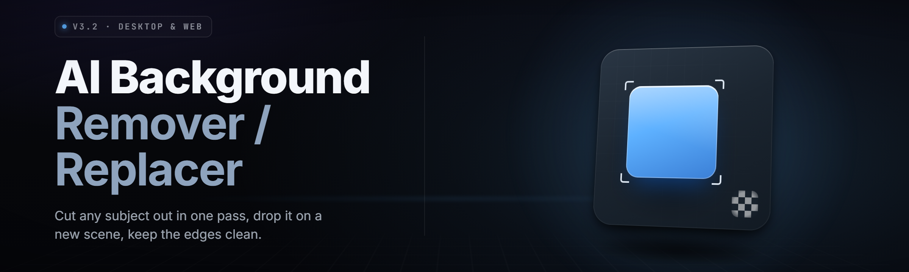

  
  
  

  

  
  

---

**AI Background Remover / Replacer Generator 2026** — batch-ready neural matting, generative background synthesis and instant cutouts, packaged as a single portable `.exe`.

---

## 📊 Compatibility Overview (UI + Runtime)

| 🔧 Platform | Status | Bit Depth | Runtime Backend | Notes |
| --- | --- | --- | --- | --- |
| Windows 11 23H2+ | ✅ Fully supported | 64-bit | DirectML / ONNX | Best tensor throughput, GPU-accelerated matting |
| Windows 10 21H2+ | ✅ Fully supported | 64-bit | DirectML / CPU fallback | Core features identical, minor speed penalty |
| Windows Server 2022 | ⚠️ Partial | 64-bit | CPU only | No GPU path, batch sizes cap at 8 |
| Windows 8.1 | ❌ Not supported | — | — | Legacy DirectML unavailable |
| Linux (via Wine) | ⚠️ Community | 64-bit | CPU only | Untested by maintainers |

---

## 🧭 Overview

| 📌 Category | Details |
| --- | --- |
| **Product name** | AI Background Remover / Replacer Generator |
| **Release line** | v2.x (2026) |
| **Distribution** | Portable `.exe` — no installer, no runtime deps |
| **Primary function** | Remove, isolate, and replace photo backgrounds using deep matting + diffusion inpainting |
| **Input formats** | `.png`, `.jpg`, `.jpeg`, `.webp`, `.bmp`, `.tiff`, `.heic` |
| **Output formats** | Transparent `.png`, layered `.psd`, flattened `.jpg` |
| **Batch mode** | Folder-to-folder with per-file queue and rollback |
| **Hardware assist** | DirectML (NVIDIA / AMD / Intel Arc), optional OpenVINO CPU |
| **Offline first** | All core models ship in-box; no telemetry, no cloud calls by default |

The AI Background Remover / Replacer Generator is a self-contained desktop utility built around a two-stage pipeline: a transformer-based matting network produces a high-fidelity alpha channel, then a background synthesis module either replaces it with a hand-picked scene, a generative prompt, or a seamless solid color fill. Everything runs locally — the `.exe` unpacks its model weights on first launch into a sidecar folder and becomes fully offline-capable afterward.

---

## 📥 Download

  

---

## ✂️ What Is the AI Background Remover / Replacer Generator

| 📖 Term | 💡 Explanation |
| --- | --- |
| **Alpha matte** | A per-pixel transparency map distinguishing foreground subject from everything behind it |
| **Foreground subject** | The retained object — person, product, animal, vehicle — isolated by the matting net |
| **Replacement layer** | The synthesized or user-supplied background composited beneath the cutout |
| **Trimap** | A three-region guide (known-fg / known-bg / unknown) that sharpens edge fidelity on hair and fur |
| **Generative fill** | Diffusion-based background generation from a text prompt or reference image |
| **Edge feathering** | Software-controlled softness applied to the outer contour for natural compositing |
| **Batch pass** | A single invocation applied to an entire folder of inputs with identical settings |

- One application handles both the *removal* and the *replacement* halves of the workflow.
- Alpha channel precision keeps fine detail: wisps of hair, fur strands, chain-link edges, spokes.
- Replacement backgrounds accept prompts, image references, or bundled studio presets.
- Runs offline after first unpack; original files are never modified in place unless you allow it.
- Everything routes through a single `.exe` — no pip, no node, no git.

---

## 🛠️ The Problem

- Cutout tools punish hair, fur, and semi-transparent edges — you get halo artifacts and ragged borders.
- Photographers re-shoot because a mediocre removal pipeline ruins an otherwise usable frame.
- Designer time burns in "select subject" cleanup instead of actual composition work.
- Online removers silently upload client imagery to a remote server — a non-starter for delivery work.
- Batch-processing 800 product shots manually is a week of lost throughput.
- Replacing a background means two tools: one to cut, another to place — never in a matched color space.
- Existing desktop apps price per-seat or lock exports behind a subscription tier.

---

## ✅ The Solution

| 😖 Problem | 🧩 Solution in This Tool |
| --- | --- |
| Halo on hair and fur | Trimap-refined matting net with dedicated strand recovery pass |
| Re-shoots from bad cutouts | High-fidelity alpha with adjustable edge feathering |
| Wasted cleanup time | Auto-select subject on import, no click-to-outline needed |
| Cloud privacy exposure | Fully local inference — nothing leaves the machine |
| Manual batch, one file at a time | Folder queue with rollback and per-file logging |
| Split cut/replace workflow | Single pipeline that removes and recomposites in one pass |
| Subscription lock on export | Local `.exe`, full-resolution exports, no tier gating |

---

## 🎯 Key Features

| ⚙️ Feature | 📝 Description | 🎁 Benefit |
| --- | --- | --- |
| Transformer matting core | ViT-backed alpha extraction trained on photo fg/bg pairs | Razor-clean edges even on messy input |
| Trimap auto-generation | Builds unknown-region mask in one pass, no manual strokes | Removes the fiddliest manual step |
| Generative background fill | Diffusion module paints a fresh scene from a text prompt | Replace without hunting stock photos |
| Reference swap | Drop in an image; the pipeline matches lighting and color | Blend seams disappear |
| Solid-color fill | Flat fills with auto ambient tint | Fast thumbnails and catalog shots |
| Batch folder runner | N inputs → N outputs with queued threading | Ship hundreds of cutouts per hour |
| Layered `.psd` export | Foreground, mask, replacement as separate layers | Hand off clean comps to design |
| Hair/fur edge boost | Dedicated high-frequency recovery on strand regions | Fur looks furry, not fuzzy-blobby |
| Color-space match | Replacement recolored to subject's lighting temperature | No warm subject on cold blue seamless |
| Shadow synthesis | Ambient contact shadow generated under subject | Grounds subjects that normally float |
| Rollback journal | Every batch writes an undo-able change log | Recover a bad pass instantly |
| Offline mode | Weights cached locally, no network dependency | Air-gapped friendly |

---

## 🧩 What Stands Behind the Cutout — Module Matrix

**🧠 Matting Core**

- **AlphaNet-T** — transformer matting backbone, the primary subject-isolation engine.
- **TrimapForge** — auto-generates known/unknown region guides from a coarse pass.
- **StrandRecover** — high-frequency module targeting hair, fur, and lattice edges.
- **MattePolish** — sub-pixel refinement to reduce edge jitter across frames.
- **MaskPreview** — live alpha visualization with toggle between matte and comp.

**🌌 Replacement Engine**

- **DiffuseBG** — prompt-driven background generation module.
- **RefMatch** — reference-image swap with histogram and tone alignment.
- **ColorWeave** — recolors replacement to match subject white balance.
- **FLATFill** — solid, gradient, and palette fill presets.
- **ShadowCast** — contact shadow synthesis under retained subject.
- **SeamBlend** — alpha-weighted compositor reducing hard contour transitions.

**📦 Batch & Pipeline**

- **FolderPump** — watches a directory, ingests new files automatically.
- **QueueWeaver** — thread pool scheduling with bounded concurrency.
- **UndoVault** — journaled change log for reversing a batch or single op.
- **SidecarNamer** — deterministic output naming with timestamps and tokens.

**🎥 I/O & Formats**

- **DecoderRing** — image decode across the supported raster set.
- **AlphaWriter** — transparent `.png` and layered `.psd` writers.
- **HEICBridge** — bridge for HEIC/AVIF input decoding.
- **ColorGuard** — ICC profile extraction, retention, and embedding on export.

**🎛️ UI & Tooling**

- **InspectorPanel** — per-layer opacity, feather, and shrink/grow controls.
- **CompareSlider** — before/after scrub between original and composite.
- **PresetShelf** — user-saved recipes for repeatable jobs.
- **KiRouter** — hotkey registry and shortcut remapping.
- **ThemeVault** — light/dark theming with accent tinting.

**🔐 Integrity & System**

- **WeightVerifier** — hash-checks model files before each session.
- **CrashSentry** — dumps state for recoverable faults on GPU paths.
- **PathScrub** — sanitizes filenames for Windows-unsafe characters.

Total shipped modules: **25**.

---

## 🔗 Table of Contents

- [System Requirements](#️-system-requirements)
- [Overview](#-overview)
- [What Is It](#️-what-is-the-ai-background-remover--replacer-generator)
- [The Problem](#️-the-problem)
- [The Solution](#-the-solution)
- [Key Features](#-key-features)
- [Module Matrix](#-what-stands-behind-the-cutout--module-matrix)
- [Usage Guidelines](#-usage-guidelines)
- [Installation](#-installation)
- [Compatibility](#-compatibility-overview-ui--runtime)
- [Known Issues](#-known-issues)
- [FAQ](#-faq)

---

## ⚖️ Usage Guidelines

| ✅ Allowed | 🚫 Not Allowed |
| --- | --- |
| Commercial photo retouching | Claiming the tool created licensed imagery you don't own |
| Batch product catalog cutouts | Stripping watermarks from others' photography |
| Personal creative compositing | Redistributing purchased presets without license |
| Educational and studio workflows | Using the replacement module to defame or impersonate |
| Off-site editing and backup exports | Circumventing contributor-licensees' content |

---

## 💽 Installation

1. **Download the archive.** Grab the portable `.exe` from the project landing page using the 

  

 macro above.
2. **Extract to a folder.** Right-click → Extract All → choose a location on any drive. The `.exe` runs fully portable; no installer, no Start Menu entries.
3. **Launch the `.exe`.** Double-click it. First launch unpacks model weights into the adjacent `weights/` folder — allow ~30 seconds and ~1.2 GB of disk for the unpacked cache.
4. **Grant GPU access (optional).** If the welcome panel flags DirectML, accept the prompt to enable GPU acceleration. On refusal the tool falls back to the CPU OpenVINO path automatically.

---

## 🖥️ System Requirements

| 🧩 Component | 🟡 Minimum | 🟢 Recommended |
| --- | --- | --- |
| OS | Windows 10 21H2 (64-bit) | Windows 11 23H2 or newer |
| CPU | 4 cores / 3.0 GHz | 8 cores / 3.6 GHz+ |
| RAM | 8 GB | 16 GB or higher |
| GPU | DirectX 12 capable (integrated OK) | 6 GB+ VRAM, DirectML supported |
| Storage | 3 GB free | 8 GB free (SSD preferred) |
| Display | 1280×720 | 1920×1080+ |
| DirectX | DX12 runtime | Latest DX12 + WDDM 3.x |

---

## ⚙️ Installation Sub-Steps

### 1. Download and verify

Copy the archive from the project page. The release contains the portable `.exe` plus three in-box preset `.json` recipes used by the PresetShelf module.

### 2. Extract cleanly

Extract the archive into a path with no trailing spaces and no forward slashes. The `.exe` writes a sibling `weights/` folder on first run — keep both together if you move the app.

### 3. First launch and GPU check

Double-click the `.exe`. The InspectorPanel dumps a short status bar showing which backend got picked. If it reports `CPU-Onnx`, GPU wasn't detected — re-check DirectX drivers.

---

## 📊 Comparison

| 🔍 Aspect | 🧾 Web-Based Removers | 🧩 This Tool |
| --- | --- | --- |
| Privacy | Uploads every image to a server | Fully offline-capable |
| Detail on hair/fur | Common halos and stair-stepped edges | StrandRecover module preserves fine detail |
| Replacement | Extra step in another app | Replaces inside the same pass |
| Batch | Tier limits, throttling | Local folder queue with no caps |
| Cost model | Subscription or credit packs | Portable `.exe`, no quotas |
| Export formats | PNG/JPG typically | PNG, PSD, JPG with layered pipeline |
| Offline | Impossible | Core path never needs a network |
| Color fidelity | Server-side defaults | ColorGuard preserves and matches ICC |

---

## 🩹 Known Issues

| 🧨 Issue | 🛠️ Fix |
| --- | --- |
| First-run unpack stalls on some HDDs | Move the `.exe` to an SSD, retry launch |
| GPU backend returns blank matte on older Intel drivers | Update via Intel DSA, or force CPU mode in Preferences |
| `.heic` files decode but drop EXIF | Convert with the built-in HEICBridge, toggle "Preserve EXIF" |
| Layered `.psd` opens flat in some editors | Use Photoshop 2023+ or Affinity Photo 2.x |
| ShadowCast doubles shadow on transparent PNG | Disable "Auto-shadow" in Export Options |

---

## 📖 Glossary

| 🧾 Word | 🔎 Meaning |
| --- | --- |
| Matte | The alpha channel describing per-pixel transparency |
| Feathering | Controlled soft falloff applied outside the subject contour |
| Shrink/Grow | N-pixel dilation or erosion of the matte boundary |
| Prompt Fill | Background generated from a short text description |
| Backend | Inference engine — DirectML, ONNX CPU, or OpenVINO |
| I/O | Input source (folder, single file) → output target |

---

## ❓ FAQ

🔄 <b>How often does the AI Background Remover / Replacer Generator get updates?</b>

Roughly every six weeks on the current v2.x line; security patches land sooner when a decoder ships a CVE.

🌐 <b>Does this work with no internet connection?</b>

Yes. Once first launch unpacks the weights folder, everything — matting, replacement, batch — runs offline.

🖼️ <b>Can it process RAW camera files?</b>

Not directly. Convert RAW → TIFF or PSD in your camera vendor's app, then drop those into the folder watcher.

👕 <b>Does it strip Steam or platform DRM?</b>

No. This is an AI background remover and replacer; nothing about DRM or gatekeeping protections applies.

🎨 <b>Can I bring my own background image?</b>

Yes — drag it into the Replacement panel and the RefMatch module aligns color and tone.

🧵 <b>Hair still looks fuzzy on my cutouts. What now?</b>

Enable StrandRecover and TrimapForge in Algorithm settings; both chip off about fifteen seconds per image but recover much finer edges.

🐢 <b>Why did the app slow down after updating the GPU driver?</b>

DataMingDirectML reruns its kernel-autotune pass after any driver change. Let it finish the first image — subsequent runs are fast.

🗂️ <b>Where are the output files saved?</b>

By default under `output/` next to the `.exe`. Change the root in Preferences → Paths.

🧾 <b>Does it support transparent PSD or just PNG?</b>

Both. Write PNG for delivery, PSD when a design team needs editable layers.

🐛 <b>I found a bug. Where do I report?</b>

Open an issue on the GitHub repo with the CrashSentry dump path and your GPU model in the header.

---

## ⌨️ Background Keyboard Shortcuts

| 🎹 Shortcut | 🎬 Action |
| --- | --- |
| `Ctrl+O` | Open image or folder |
| `Ctrl+Shift+R` | Run current preset on selection |
| `Ctrl+E` | Export composite |
| `Space` | Toggle CompareSlider overlay |
| `M` | Toggle mask preview |
| `Shift+B` | Batch run folder queue |
| `Ctrl+Z` | Roll back last operation via UndoVault |

---

The AI Background Remover / Replacer Generator ships as a portable `.exe` designed to replace the whole two-app cutout workflow with one disciplined pipeline. The 2026 release line focuses on edge fidelity, offline-first privacy, and a folder-batch runner that keeps up with production volume. Whether you are clearing a single portrait or a thousand product shots, the pipeline holds. Download the current build and match it to your workflow.

  

